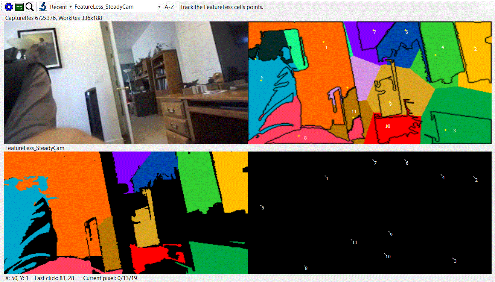
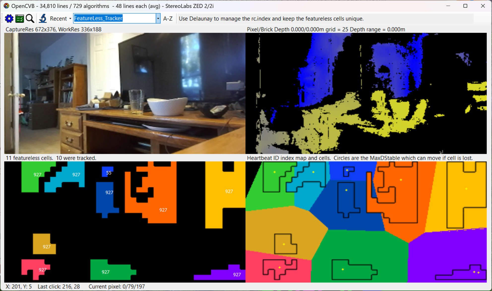
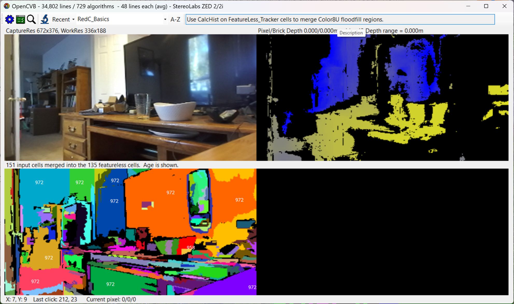

**October 31, 2026 – FeatureLess, Resolution, TreeView,**

-   There are over 1700 algorithms in various stages of development.
    -   Readme.md had to be trimmed – too big lately…
-   The UI_Generator report:
    -   1722 classes will be visible in the user interface
    -   Total source lines for visible classes: 66142
    -   XR\_ Reference algorithm count: 975
    -   Cursor.ai algorithms: 74
    -   Average lines per visible algorithm: 38
    -   Algorithm groups: 203
-   FeatureLess_Basics and Delaunay_FeatureLess are now task algorithms.
    -   These algorithms allow each RedC cell to be tracked.
    -   The color of the cell is used to confirm the tracking results.
    -   On the heartbeat, the colors are reset along with the maxDStable points.
-   An improved TreeView display now handles duplicate references to algorithms.
    -   Duplicate algorithms needed to be distinctly identified.
    -   Treeview code is now much simpler to read and review.
-   Task algorithms may be selected as the current active algorithm.
    -   Rather than rerun the algorithm that has already run, just present results.
    -   A list of task algorithms is now maintained in MainUI.vb.
-   RedC cells are the combination of RedColor cells connected to a Delaunay cell.
    -   Colors and map are consistent for the duration of the heartbeat.
-   

****

**FeatureLess_SteadyCam:** *When the colors remain the same in the lower left image even with camera movement, it indicates the main objects are being tracked. The mechanism to track objects is the upper right which shows the Delaunay map taken on the heartbeat (enhanced with the featureless cells.) The maxDist point for each cell is tracked in the lower right using the SteadyCam M transform to back project the maxDist point to the original map. The map in the upper right is updated on the heartbeat. The cells in the lower left can come and go as well as change shape but are still likely to be mapped correctly. Radical camera motion can cause a color change.*

**October 15, 2026 – FeatureLess Cells, Air Gap Cells, Line_Basics, Octree, Rasterization, Intensity Transform, LineIterator, Guided Filter, “XR_”**

-   There are over 1700 algorithms in various stages of development.
-   The (updated format) UI_Generator report:
    -   1737 algorithms will be visible in the user interface.
    -   Total source lines for algorithms: 66,319
    -   XR\_ algorithms (Reference) algorithms: 994
    -   Cursor.ai algorithms: 67
    -   Average lines per visible algorithm: 38
    -   Algorithm groups: 205
-   FeatureLess_Tracker is a simpler solution to tracking featureless regions.
    -   Each featureless region becomes a Delaunay cell.
    -   A new Delaunay map is created after a heartbeat for each featureless cell.
    -   The Delaunay map helps identify a cell even when there is motion.
    -   See the image below to understand further the value of the Delaunay map.
-   The tracked featureless cells contribute to the RedC_Basics results.
    -   The air gap between featureless cells contains features and edges.
-   Line_Basics has long been a task algorithm that is run on every frame.
    -   An improved usage means only algorithm using lines will activate it.
    -   Several algorithms may invoke Line_Basics so it is shared automatically.
    -   Line_Basics is still a task algorithm but active only when needed.
    -   Task algorithms are not typically expensive but may use the same treatment.
-   Some simple examples of Octree and rasterization were added in Octree.vb.
    -   Some SharpGL algorithms were also added to display the results.
-   An intensity transform algorithm was added and is currently the grayscale default.
    -   It appears to get better segmentation and will continue to be evaluated.
-   The “LineIterator” algorithm was added to identify pixels in a line.
-   OpenCVSharp version was upgraded to the latest version.
-   The XimgProc::GuidedFilter was added to possible use filling depth data gaps.
    -   It is not being used yet to produce the depth data in other algorithms.
-   All the XR\_ algorithms are now enabled and available in the user interface.
    -   XR\_ algorithms are mostly for reference but can be reactivated again.
    -   By enabling and testing XR\_ algorithms, they can be easily reactivated.

**FeatureLess_Tracker:** *The lower left image shows the identified featureless cells. The lower right image overlays the featureless cells on a Delaunay subdivision of the image using the maxDist for each cell. MaxDist is defined as the interior point farthest from the edges of the cell. The Delaunay cells allow each featureless cell to be tracked during camera and scene motion. The Delaunay cells are updated on the heartbeat.*

**RedC_Basics:** *The lower left image maps all the featureless cells as well as air gap between featureless cells. The air gap is segmented by color as in previous versions. The colors of the featureless cells are much more consistent while all other cells frequently change color and shape as in previous versions. The age is shown for featureless cells.*
